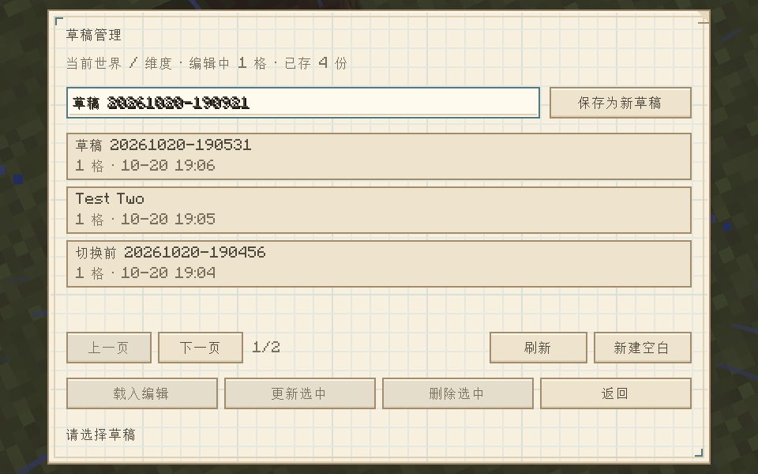
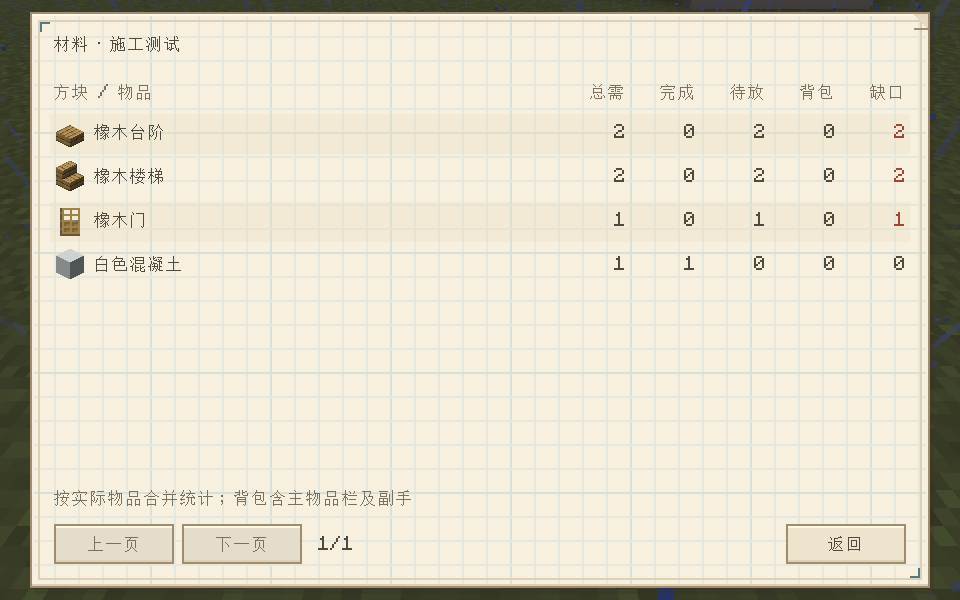

# 筑稿 · Build Draft

**先在世界里设计建筑草稿，再按材料一键建造。**

筑稿是 Minecraft **1.20.1 / Fabric** 建筑辅助 Mod：用无碰撞自由视角贴着地形设计，保存多份草稿，查看虚实投影与材料清单，在单人世界中按材料一次填充整份草稿。

[下载最新版](https://github.com/YiJie-ZhongXin/build-draft/releases/latest) · [详细使用指南](docs/usage.md) · [更新记录](CHANGELOG.md) · [反馈问题](https://github.com/YiJie-ZhongXin/build-draft/issues)

## 能做什么

- **自由视角设计**：类似旁观视角，可穿过方块自由移动，Ctrl 加速；编辑时隐藏手部和持物。
- **贴面建造与选材**：准星对准地形或草稿表面放置，滚轮切换 12 格方块栏；分类、搜索和最近使用帮助快速找材料。
- **多份草稿管理**：命名保存、新建、载入、更新和删除，按世界与维度分别保存。
- **虚实投影**：已保存草稿可切换虚影或原材质显示，已完成位置自动隐藏，冲突位置标红。
- **材料清单**：统计总需、完成、待放、背包及缺口，按实际物品合并不同朝向的方块。
- **同材质一键填充**：单人世界手持对应方块，左 Alt + 右键一次填充整份草稿中该材料的位置。
- **撤销与重做**：支持 Ctrl + Z / Ctrl + Y；全部清空设计也可一次撤销。

## 安装

| 环境 | 要求 |
| --- | --- |
| Minecraft | Java 版 1.20.1 |
| Fabric Loader | 0.19.5 或以上 |
| Fabric API | 0.92.2+1.20.1 或兼容版本 |
| Java | 17 或以上 |
| 当前版本 | 0.15.0 |

1. 安装对应 Minecraft 版本的 Fabric Loader 和 Fabric API。
2. 从 [Releases](https://github.com/YiJie-ZhongXin/build-draft/releases/latest) 下载 `build-draft-0.15.0.jar`，放入游戏实例的 `mods` 文件夹。
3. 启动游戏。升级时先退出游戏并移除旧版筑稿 JAR，同一实例只保留一个版本；不要安装 `-sources.jar`。

## 四步开始

1. **设计**：进入世界按 **End** 打开编辑器；WASD 飞行，鼠标转向，右键添加草稿方块，左键删除草稿方块。
2. **选材**：滚轮切换方块栏，按 **F** 打开分类方块库；按 **V** 切换实景 / 虚影，Ctrl + Z 撤销。
3. **保存与投影**：按 **L** 打开草稿页，命名保存，选中草稿并开启施工投影；返回普通游戏。
4. **按材料建造**：主手拿对应材料，按住 **左 Alt** 并右键一次，填充整份草稿中所有使用该物品的待建位置，无需瞄准或走近。

生存模式从背包、快捷栏及副手按实际数量扣料，材料不够就填到用完，补料后再次触发；创造模式不扣料。已完成位置不重复扣料，已有方块冲突或实体占位会跳过。门和床需完整成组设计，双台阶按缺少的材料补齐。

## 常用操作

| 操作 | 默认按键 |
| --- | --- |
| 打开 / 关闭编辑器 | End |
| 前后左右飞行 | WASD |
| 上升 / 下降 / 加速 | 空格 / Shift / Ctrl |
| 释放 / 捕获鼠标 | Tab |
| 添加 / 删除草稿方块 | 右键 / 左键 |
| 切换方块 / 打开方块库 | 滚轮 / F |
| 吸取方块 / 旋转方块 | 中键或 M / R |
| 实景与虚影切换 | V |
| 撤销 / 重做 | Ctrl + Z / Ctrl + Y |
| 草稿管理 | L |
| 单人同材质一键填充 | 左 Alt + 右键 |
| 视角返回玩家 | Home |

呼出、预览、旋转、吸取、方块库、返回玩家、草稿管理及施工辅助可在 Minecraft 按键设置中改绑。更多操作和保存位置见[详细使用指南](docs/usage.md)。

## 界面预览

以下为开发版本实机截图，分别展示草稿列表和材料统计，具体按钮以当前版本为准。





## 当前范围

设计和投影在客户端运行；**整份真实填充当前仅支持单人世界**，多人连接需要服务端支持，本仓库尚未提供多人服务端组件。

一键填充会真实修改世界并扣除材料。世界边界、修改权限、实体占位及正常支撑 / 重力规则仍会生效，依赖支撑的材料应先建好支撑。液体、含水状态、方块实体 NBT 和部分特殊模组方块需手工处理。较大或分散的草稿在加载区块和批量写入时可能短暂卡顿。

自由视角不移动玩家本体，设计阶段只显示游戏已加载区块。草稿保留原世界坐标，每份最多 32,768 格。0.15.0 已通过构建与 **85 项单元测试**，整批真实放置和完整整合包兼容性仍待游戏内验收，见[验证说明](VALIDATION.md)。

## 从源码构建

使用 JDK 17 或 21，首次构建需要联网下载依赖。

```powershell
# Windows，兼容含中文的项目路径
.\build.ps1

# 单独运行测试
.\build.ps1 -Tasks test
```

```sh
# Linux / macOS
./gradlew build
```

安装包输出至 `build/libs/build-draft-0.15.0.jar`。构建依赖的 Minecraft、Fabric、Iris / Sodium 等第三方内容不包含在源码仓库或发布安装包中。
