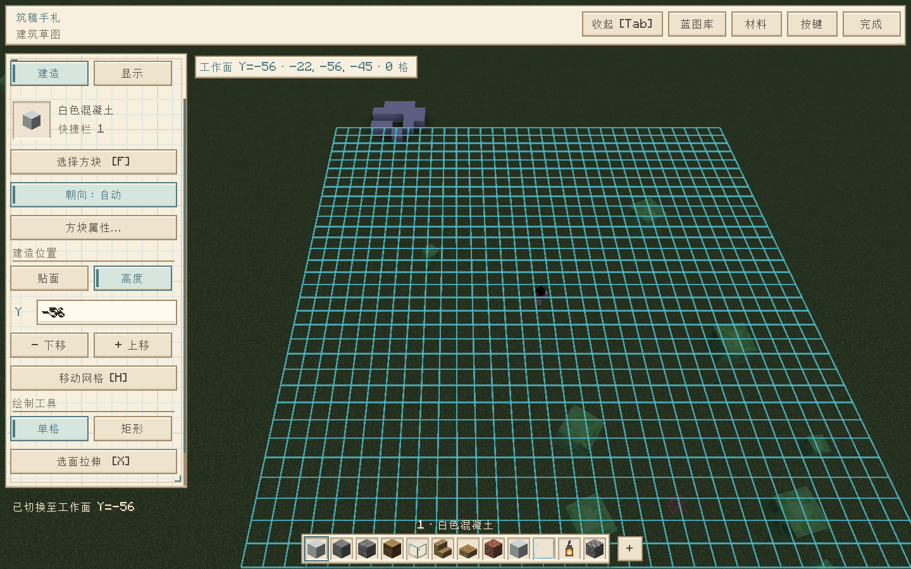
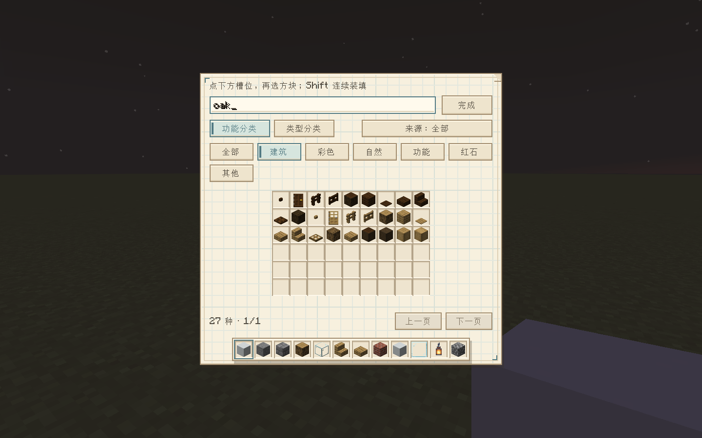

# 筑稿 · Build Draft 0.9.0

Minecraft **1.20.1** / Fabric Loader **0.19.5** 的客户端建造辅助原型。在实际世界上方使用可 360° 环绕的斜俯视相机，用虚拟方块绘制草稿，保存为蓝图，再通过投影手动施工。

当前版本 **0.9.0**：暖色图纸界面、12 格选材容器、可收起工具面板与独立移动辅助网格。安装包可在仓库的 **Releases** 页面下载；构建方法见下文。





0.2.0 新增深色工具界面、可滚动侧栏、带图标的全注册表方块库、按键设置入口，以及实景 / 虚影材质预览。默认俯角 55°，可调整为 20°–85°。

0.2.1 新增功能 / 类型分类切换：可在分类内继续搜索名称或 ID，并用“来源”筛选原版或模组。

0.3.0 改为默认自由贴面搭建：直接点草稿顶面向上放置、点侧面延伸。新增锁定水平 / 竖直平面、选面拉伸、下一块材质预览与 Alt 穿透选择，所有高度的草稿同时显示。

## 0.9.0 更新

- 统一为温暖的建筑图纸 / 手札风格：米白纸底、淡色方格、浅棕铅笔边线、纸页折角和图纸定位记号；按钮使用暖米色，选中状态为柔和蓝绿色，悬停为蜂蜜暖黄色。
- 编辑器、12 格选材栏、方块库与各工作页面使用同一套纸张风格。世界 Y、搜索、蓝图名称、方块 ID 输入框也改为浅色纸面；透明度滑杆采用图纸刻线样式。
- 保留默认收起、Tab 展开、全部 12 格选材快捷键，以及已有网格 / 草稿操作和光影兼容渲染。

## 0.8.0 更新

- 下方选材容器从 9 格扩至 12 格，编辑器和方块库共享全部槽位。新增槽位默认提供玻璃板、灯笼、圆石；首次进入时仍只复制玩家原版 9 格物品栏，不修改玩家物品。
- 1–9 对应前 9 格，0、-、= 对应第 10–12 格；也可点击或在容器上滚轮循环全部 12 格。右键任意槽位打开方块库替换，Shift 连续装填可以跨过第 9 格。
- 编辑器、选材容器、方块库、蓝图库、材料清单和方块属性页统一为 MC 灰色容器：浅灰面板、像素立体边框、凹槽、灰色按钮和一致的选中颜色。保持默认收起与 Tab 展开操作。

## 0.7.0 更新

- 草稿材质模型、下一块预览和拉伸预览改为在实体阶段提交到世界渲染缓冲，由原版 / Iris 管理实心和透明绘制；不再在世界渲染末尾另行绘制材质，避免与光影合成流程冲突。辅助网格和选框在世界 / 光影合成完成后单独绘制，保留操作可读性。
- 编辑器默认收起，只显示左上角“工具 [Tab]”入口、简短高度 / 数量和下方原版九格快捷栏。顶部整条菜单、侧栏、底部整条深色背景均收起，空出的区域可正常操作世界。
- 点击“工具 [Tab]”或按 Tab 展开完整工具，再点击“收起 [Tab]”或按 Tab 收起。在当前世界的草稿会话中记住展开状态，进入方块库再返回不会自动展开。
- 收起时数字 1–9、右键快捷槽换材、H 移动网格、Q/E 升降、鼠标建造等操作继续可用，Esc 完成编辑。

## 0.6.0 更新

- 辅助网格与蓝图原点分离。移动网格时已有草稿留在原位，蓝图坐标与撤销历史不会重写。
- 按 H 或点击“移动网格”：左键拖动水平移动；Shift+左键上下拖动升降。方向键按相机朝向逐格微调，Shift+方向键每次 8 格。再按 H 或选择“单格”返回建造。
- Ctrl+中键可直接拖动网格，Ctrl+Shift+中键拖动升降。普通中键仍环绕，Shift+中键仍移动相机。
- 移动网格模式下滚轮调整高度；Q/E 或 Shift+滚轮也可逐层调整。逐层调高低时相机不再自动跟随，可直接看见网格相对方块移动；输入世界 Y 后回车仍会把相机高度移到该工作面。
- Home / “居中到工作面”会把相机对准当前网格；显示页的“网格回原点”只复位网格。顶部显示网格世界坐标，Esc 可取消当前拖动。
- 网格显示范围仍为 32×32，但可以独立移动，不再限制蓝图水平坐标。保留每份蓝图最多 32,768 格；实际建造遵守世界坐标和高度范围。新版本可加载旧蓝图；跨出旧范围的新蓝图无法由旧版加载。

## 0.5.0 更新

- 编辑器下方常驻原版 9 格快捷栏，使用 Minecraft 自带的快捷栏和选中框贴图。左键或数字 1–9 选用，右键槽位或点击“+”打开方块库，在快捷栏上滚轮循环切换。
- 方块库采用灰色容器、9 列物品槽和下方快捷栏，默认打开“建筑”分类。选材后保持打开，可一次配置多种材料；点击下方槽位再点击方块替换，完成后返回建造。
- 鼠标悬停在库内方块上按 1–9，直接装入对应快捷槽；Shift+点击会装入当前槽后移动到下一槽，便于连续装填。
- 首次进入世界时复制玩家快捷栏中的方块，其余槽位补入常用建筑材料。不会修改玩家真实物品栏；自定义槽位在当前草稿会话中保留，关闭再打开编辑器仍在。
- 槽位保存各自画笔的方块属性，旋转或吸取后切走再切回仍保留该状态。自动 / 手动朝向开关仍为编辑器全局设置。

## 0.4.0 更新

- 改良 Minecraft 风格：石灰色立体按钮、物品槽、草绿色选中状态；顶部紧凑工具栏，左侧分为“建造 / 显示”，按 Tab 折叠。相机中心随可用画布调整；编辑期间隐藏原版 HUD，退出后恢复。
- 右键放置、左键删除；按住每约 180 毫秒连续操作，贴面模式每次重新选面，不再自动锁住第一下的高度。
- “高度”模式直接输入世界 Y 并回车，或用 Q/E、Shift+滚轮调整。工作网格与落点不受已有方块遮挡。高度可低于草稿原点，不再限制为 64 层，实际放置遵守所在维度的世界高度。
- 自动朝向使用原版方块放置状态计算，并在计算期间读取草稿邻居，支持台阶合并、上下半块、楼梯朝向、原木轴向等；预览与写入使用同一个状态。R 旋转、吸管和属性修改会切到手动属性模式。
- 旧版蓝图可以读取，新版保留同一格式与坐标原点；含负高度或超过 63 层的新蓝图无法由旧版载入。

## 安装

1. 准备 Minecraft 1.20.1、Fabric Loader 0.19.5、Java 17 或以上。
2. 在对应游戏实例的 `mods` 目录放入 **Fabric API 0.92.2+1.20.1 或兼容的更新版**。
3. 放入 `build-draft-0.9.0.jar`，不要放入 `-sources.jar`；同一实例只保留一个版本的筑稿 Mod。
4. 进入世界，找一块空地，按 **B** 打开编辑器。按键冲突时可在游戏的“选项 → 控制 → 按键绑定 → 筑稿”修改入口按键。

这是客户端 Mod，不需要服务端安装。服务器上是否允许此类辅助工具以服务器规则为准。

## 工作流程

1. 在目标地面附近站好，瞄准地面后按 **B**。辅助网格初始显示 **32 × 32 格**，可独立移动，高度遵守世界范围，以瞄准点为中心；未瞄准方块时使用玩家所在高度。
2. 右键下方快捷槽或点击“+”，切换“功能分类”或“类型分类”，在分类内按名称或注册 ID 搜索；点击“来源”循环筛选全部 / 原版 / 模组方块。配置下方多个快捷槽后点击“完成”，对着地面右键放第一块，再点草稿顶面或侧面继续搭建。左键删除草稿。
3. **无需换层即可向上搭建**。中键拖动环绕，Shift + 中键拖动在相机平面中平移，也可抬高视角；WASD 水平平移。滚轮在世界画面上缩放，在侧栏上滚动工具面板。
4. 按 Tab 展开工具，点击“蓝图库”，输入名称并保存。需要恢复未命名工作时，选择“恢复自动保存”。
5. 选择“实景”观察原材质外观，或选择“虚影”查看半透明投影。不透明度可以调节。按呼出键（默认 **B**）/ **Esc** 或点击“完成”退出编辑。蓝图留在世界中显示。
6. 青色表示待建，橙色表示现有方块或属性冲突。真实方块及状态与蓝图相符时，施工投影自动隐藏该格。俯视编辑中已完成格显示为绿色。
7. 按照投影手动放置真实方块；用“材料”查看各方块的总格数、未完成格数和冲突数。

## 操作

### 自由搭建、平面和拉伸

- 默认“自由贴面”：识别鼠标下最近的草稿表面或真实地形，在相邻一格显示待放置虚影。绿色框表示可放置，红色框表示删除目标或无效位置。按住右键连续放置时持续重新选面；需要固定高度请切换“高度”模式。
- 按住 **Alt** 会淡化并忽略草稿，方便选择后面的真实地形；真实方块仍然参与遮挡。
- 指向一个面后按 **L** 锁定建造平面，再按释放。顶面锁定水平面，侧面锁定竖直面；可连续画地板、楼板或墙面。侧栏也可切换“自由贴面 / 锁平面”。
- 矩形工具：第一角所在表面确定平面，第二角完成矩形。支持水平和竖直矩形；第二次右键填充，左键删除，Esc 取消。
- 按 **X** 或点击“选面拉伸”。右键按住草稿的外露表面向外拖动，预览拉伸距离与新增数量，松开右键一次提交，**Ctrl+Z 一次撤销整次拉伸**。滚轮可在拖动时逐格微调，Esc 取消。
- 拉伸默认选取相连、同一平面、同一方块状态的外露面，因此一排同材质地基可以拉成墙；按住 **Shift** 开始拉伸只选当前一格，可拉成柱子。支持上、下、左、右、前、后六个方向。
- 拉伸不会覆盖已有草稿，每条延伸路径遇到草稿就停止；达到地块边界、世界高度或总数量限制时受限。它只生成设计草稿，不放置真实方块。
- Q / E 或 Shift+滚轮用于移动水平工作面，按 Home 可将相机对准它；完成后用 L 释放即可回到自由搭建。原有蓝图文件可继续载入。

方块库的“功能分类”包含全部、建筑、彩色、自然、功能、红石、其他；“类型分类”包含全部、楼梯、台阶、围挡、门窗、光源、容器、植物、流体、其他。只应用当前分类页的选项，切换分类或来源会回到第一页。

功能分类优先采用当前游戏创造物品栏的分类（包括其他 Mod 向这些分组添加的方块）；自定义 Mod 分组中的方块根据标签与方块类型推断，未识别内容归入“其他”。同一方块可属于多个分类，例如发光容器同时属于光源和容器。光源检查所有方块状态，因此关闭的红石灯也能找到。“全部”始终保留所有已注册的非空气方块。

| 场景 | 操作 | 功能 |
| --- | --- | --- |
| 普通游戏 | B | 开启俯视编辑器（可重新绑定） |
| 普通游戏 | P | 显示 / 隐藏投影（可重新绑定） |
| 普通游戏 / 编辑器 | V | 实景 / 虚影预览（可重新绑定） |
| 普通游戏 | N | 将蓝图的 **局部原点 (0,0,0)** 移到准星所指方块的相邻面（可重新绑定） |
| 编辑器 | 右键 / 左键 | 对着顶面或侧面放置 / 删除草稿，可按住连续操作 |
| 编辑器 | Tab | 折叠 / 展开工具栏 |
| 编辑器 | 高度输入框 + Enter | 切到指定世界 Y 的水平工作面，支持悬空起建 |
| 编辑器 | G | 切换单格 / 矩形工具；矩形点击两角，第二次右键填充、左键删除 |
| 编辑器 | L | 锁定 / 释放建造平面（可重新绑定） |
| 编辑器 | X | 开启 / 关闭选面拉伸（可重新绑定） |
| 编辑器 | Alt | 临时淡化并穿透选择草稿 |
| 编辑器 | Q / E，或 Shift + 滚轮 | 下移 / 上移辅助网格，相机不跟随 |
| 编辑器 | H | 切换移动网格模式；左键水平拖动，Shift+左键升降 |
| 编辑器 | Ctrl+中键 / Ctrl+Shift+中键 | 直接水平移动 / 升降网格，已有方块留原位 |
| 移动网格 | 方向键 / Shift+方向键 | 按相机朝向微调 1 / 8 格 |
| 移动网格 | 滚轮 | 升降辅助网格 |
| 编辑器 | 世界画面上的滚轮 | 缩放，相机至中心距离 8–96 格；侧栏上的滚轮滚动面板 |
| 编辑器 | 中键拖动 | 水平 360° 环绕、上下调整俯角 |
| 编辑器 | WASD / Shift+中键拖动 | 水平 / 相机平面内平移；后者也可抬高视角，“居中”回到地块中心 |
| 编辑器 | F | 打开带图标、搜索与筛选的方块库（可重新绑定） |
| 编辑器 | Home | 视角居中（可重新绑定） |
| 编辑器 | 1–9、0、-、= / 点击下方槽位 | 从 12 格选材容器选择建材，保留每个槽位的方块属性 |
| 编辑器 | 右键下方槽位 / + | 为当前槽位打开方块库 |
| 编辑器 / 方块库 | 快捷栏上的滚轮 | 循环切换 12 个建材槽 |
| 方块库 | 指着方块按 1–9、0、-、= | 将方块放入指定槽，不用退出方块库；输入框聚焦时 -、= 用于搜索 |
| 方块库 | Shift+点击方块 | 装入当前槽后移动到下一槽 |
| 编辑器 | M | 吸取鼠标下草稿方块状态；无草稿时吸取同一格的真实方块 |
| 编辑器 | R | 将画笔方块旋转 90°，如楼梯的朝向 |
| 编辑器 | “方块 / 属性” | 输入注册 ID，例如 `minecraft:oak_stairs`；点击属性切换朝向、半层等 |
| 编辑器 | Ctrl+Z / Ctrl+Y | 撤销 / 重做；矩形和整次拉伸各为一步，单格拖画按格记录 |
| 编辑器 | 当前呼出键 / Esc | 关闭编辑器并自动保存；Esc 优先取消进行中的矩形 / 拉伸 |

点击顶部“按键”即可打开 Minecraft 按键设置，在“筑稿 · 建造辅助”分类修改呼出、投影显隐、原点、实虚预览、楼层、绘制工具、旋转、吸管、方块库与居中按键。改绑由游戏保存在 `options.txt`；界面提示和关闭编辑器的按键同步更新，也支持原生设置中的鼠标按键绑定。WASD、数字快捷栏、Ctrl+Z/Y 和鼠标视角手势目前固定。编辑时相机移动，玩家本体不跟随相机移动。编辑器不暂停游戏，世界继续运行。

实景和虚影都只是外观预览，无碰撞、不消耗材料、不放置真实方块。实景保留玻璃等材质本来的透明特性；虚影额外施加 15%–80% 的不透明度。该外观选择和相机参数目前在当前草稿会话中保留，重新进入世界会回到默认值。

## 蓝图与数据

文件位于**当前游戏运行目录**的 `build-draft/` 中：

```text
build-draft/
  blueprints/蓝图名称.json        # 命名蓝图，可跨世界载入
  autosaves/<世界与维度摘要>/recovery.json
```

- 命名蓝图保留相对坐标、方块注册 ID 和全部 BlockState 属性。加载后使用当前草稿原点，可用 N 重新定位。
- 自动保存每 10 秒执行一次，也会在关闭编辑器、离开世界时执行。它是每世界/维度的一份恢复副本；新编辑会覆盖该副本。长期保留请命名保存。
- 换世界、断线、跨维度会清理当前显示，避免把一个世界的投影留到另一个世界。
- 保存采用临时文件和替换写入；载入会验证版本、坐标、数量、重复格、方块 ID 和属性。缺少其他 Mod 提供的方块时拒绝载入并提示。
- 每份蓝图最多 32,768 格，最多保留 128 步编辑历史。

## 首版边界

- 普通模型使用原材质、方块状态和颜色；特殊方块实体与流体使用对应的原版渲染入口。无实体模型的不可见方块以轮廓标记。某些第三方特殊渲染器可能不兼容，会记日志并退回轮廓；尚未逐个验证全部方块或整合包渲染效果。
- 贴面搭建以方块网格为单位，使用草稿的轮廓形状识别表面；支持台阶自动合并和新放楼梯的形状计算；尚未完整重放邻居更新或多格结构自动补全。门、床等仍需分别设计各格。
- 不提供自动放置、远程放置、材料消耗或一键生成建筑。
- 当前显示可移动的 32×32 辅助网格，草稿可超出网格范围；没有任意地块选区、整图旋转/镜像、协同编辑或 `.litematic` 导入导出。
- 支持方块状态，不保存箱子物品、告示牌文字、实体和其他方块实体 NBT。门、床等多格结构需要分别设计各格，材料清单统计的是格数而非准确物品消耗量。
- 普通投影只绘制已加载区块、距相机 128 格内的内容；编辑距离为 256 格，显示全部草稿高度，不会额外加载远处区块。
- 已在独立开发环境实测 Iris 1.7.6、Sodium 0.5.13 和 Derivative Main d24.4.14，包含光影开启 / 关闭、草稿材质、网格和界面收起；细节见 `VALIDATION.md`。完整整合包、其他光影与其他相机 Mod 仍需分别验证。

## 从源码构建

使用 JDK 17 或 21，首次需要联网获取依赖。

```powershell
# Windows，特别是工程路径包含中文时
.\build.ps1

# 其他环境 / 全英文路径
.\gradlew.bat build
# macOS / Linux
./gradlew build
```

产物在 `build/libs/build-draft-0.9.0.jar`。Windows 脚本用临时目录中的目录链接处理 Gradle 测试进程对中文路径的编码问题，不移动源码。

```powershell
.\build.ps1 -Tasks test
.\build.ps1 -Tasks runClient
```

开发客户端的配置与测试存档位于工程的 `run/`。源码按 `model`（独立蓝图与历史）、`io`（JSON 文件）、`screen`（编辑 UI）、`DraftRenderer`（投影）、`mixin`（相机）拆分。

## 后续方向

继续覆盖更多光影和特殊方块的材质预览及贴面操作，再考虑任意选区、整图旋转镜像、投影层筛选以及 `.litematic` 互通。

技术参考：[Fabric Loader 0.19.5 官方仓库](https://maven.fabricmc.net/net/fabricmc/fabric-loader/0.19.5/)、[1.20.1 Camera 映射文档](https://maven.fabricmc.net/docs/yarn-1.20.1%2Bbuild.10/net/minecraft/client/render/Camera.html)。
